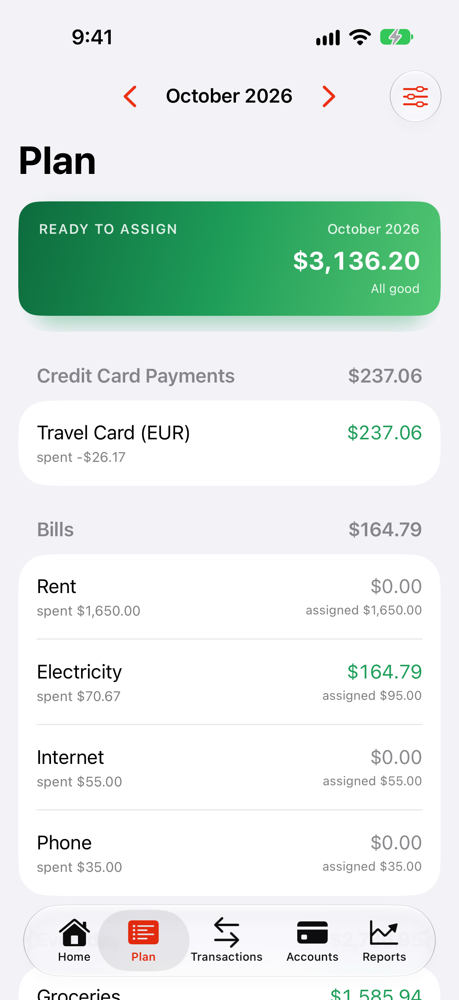
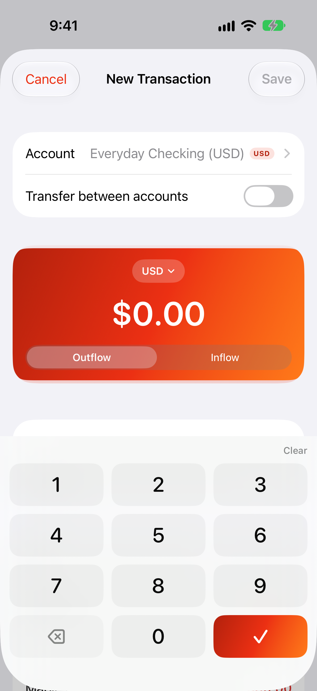
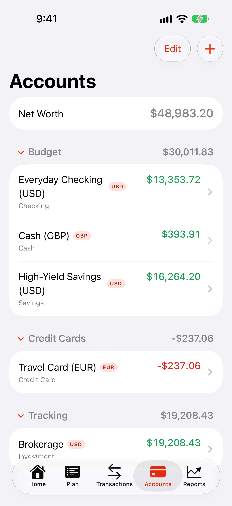
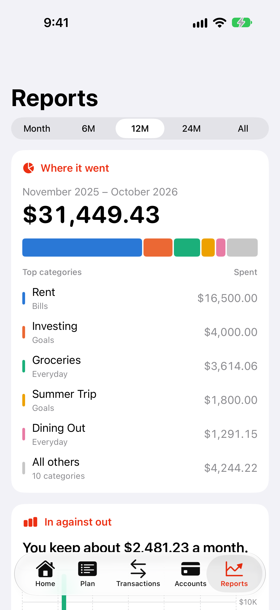

<p align="center"></p>

<h1 align="center">Embers</h1>

<p align="center">A private envelope budget for iPhone, iPad and Mac.<br>
<a href="https://getembers.app">getembers.app</a></p>

<p align="center">
  
  
  
  
</p>

Plan the money you already have, category by category, before you spend it. Every account can
hold its own currency, with your bank's foreign-exchange fee folded into what is recorded. Your
budget syncs through your own iCloud — there is no account to create and no server.

- Envelope budgeting with Ready to Assign, credit-card payment categories and planning ahead
- Per-account currencies, daily rates for 160+ currencies kept offline, and a bank FX fee
- Scheduled and repeating transactions that wait for approval
- Reminders scheduled on the device, with Approve and Skip from the notification
- Reports: where it went, income against spending, net worth
- Reconciling, transfers on and off budget, a budget check
- iCloud sync, backups to iCloud Drive, and import from a YNAB export
- English, Arabic, German, Spanish, French, Brazilian Portuguese, Japanese and Simplified Chinese
- A native Mac app alongside the iPhone and iPad one

## Building

Xcode with the iOS 18 and macOS 15 SDKs or later. Open `Embers.xcodeproj` and run the `Embers`
(iPhone and iPad) or `EmbersMac` scheme. iCloud sync needs your own team and iCloud container in
Signing & Capabilities.

```bash
cd Packages/EmbersCore && swift run selfcheck     # the budget rules, headlessly, in seconds
```

## License

The source is [MIT-licensed](LICENSE). The App Store version is a paid download, which covers the
cost of publishing it; you are free to build it yourself.
